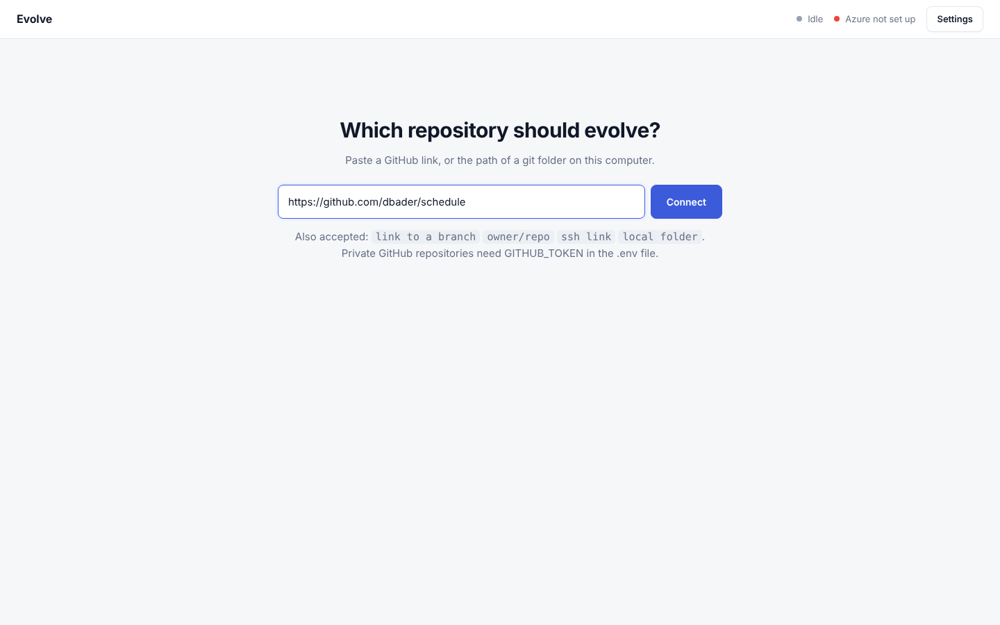

# Evolve

Paste a repository link. Evolve finds what is worth fixing, plans the change, has independent reviewers challenge the
plan, builds it inside enforced limits, proves it with tests, and keeps or undoes it. Everything is recorded in plain files.



```
repo link
   |
0 DISCOVER      1 PLAN        2 REVIEW       3 BUILD        4 VERIFY             5 DECIDE
plain tools  -> Elephant  ->  Goldfish   ->  Pi agent  ->  tests + Goldfish ->  keep or roll back
find evidence   writes the    zero-context   edits only     fail-before proof    (a human approves
Elephant ranks  ECP           reviewers      declared files                      high-risk work)
```

| Name | Job | Key rule |
|---|---|---|
| Elephant | Reads the repository, its rules and past changes. Finds problems and writes the ECP. | Never writes code. |
| Goldfish | Reviewers, each with no memory of how the plan was made, each checking one thing. | Sees only the ECP and the files it names. |
| Pi | The coding agent. Builds exactly what the approved ECP says. | Cannot touch files outside the ECP's scope. Enforced, not requested. |
| ECP | The document holding plan, rules, evidence and outcome. Locked on approval. | Every change leaves one. |

## Run it

Needs Python 3.10+, git, Node 20+ (for Pi) and an Azure OpenAI deployment.

```bash
pip install -e ".[dev]"
npm i -g @earendil-works/pi-coding-agent
cp .env.example .env        # then fill in the Azure values
evolve start                # opens http://127.0.0.1:8765
```

Then paste a repository link and press Connect. Full steps, accepted link forms and troubleshooting are in
[docs/SETUP.md](docs/SETUP.md). What each part of the page shows is in [docs/DASHBOARD.md](docs/DASHBOARD.md).

## What it leaves in the repository

```
.evolution/
  config.yaml              test command, sandbox, optional per-role deployments
  rules.md                 rules every plan must follow
  source.json              where the repository came from
  findings/F-001.json      each discovered problem, with its evidence
  ecps/ECP-0001.md         the plan (YAML header + Markdown), hash-locked on approval
  versions/                every version of each plan
  evidence/ECP-0001.jsonl  append-only, hash-chained record of what happened
  events/ECP-0001.jsonl    the live feed, kept so a run can be replayed
  history.jsonl            what past changes taught (the Elephant reads it next time)
```

## Commands

| Command | What it does |
|---|---|
| `evolve start` | The application (also just `evolve`) |
| `evolve prepare --repo X` | Clone if needed, install dependencies privately, run the tests for a baseline |
| `evolve discover --repo X` | Find and rank problems |
| `evolve run "request" --repo X` or `--finding F-001` | Evolve from a request or a finding |
| `evolve show ECP-0001`, `evolve plan-diff ECP-0001` | Inspect a run |
| `evolve doctor [--ping]` | Is this computer ready? |
| `evolve sandbox build` | Build the Podman image Pi can run in |

`X` is a link or a folder.

## Limits

- Findings and reviews are model opinions. Evidence comes from plain tools (tests, bandit, ruff, coverage), and every bug
  fix must show its new test failing on the old code.
- Discovery tools cover Python well. Other languages get the repository's own tests plus the Elephant's reading.
- The repository needs tests, otherwise nothing can be verified.
- A person picks which finding to evolve.
- Without Podman, the target repository's tests and Pi run on this computer. Do not connect repositories you do not trust.

More: [HOW_IT_WORKS](docs/HOW_IT_WORKS.md), [DISCOVERY](docs/DISCOVERY.md), [TESTING](docs/TESTING.md).
