# The dashboard

`evolve start` serves one page at http://127.0.0.1:8765. It is built from the same files the run writes, so nothing on the
page is invented: the live view is `.evolution/run/live.jsonl`, and every finished run keeps its feed in `.evolution/events/`
so it can be replayed.

## Connect

Paste a link or folder. Progress shows each step: link check, download with a percentage, private environment,
dependencies, baseline tests. See [SETUP](SETUP.md) for accepted links.

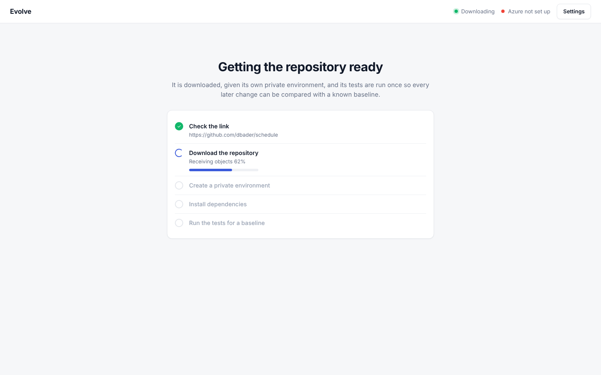

## Find problems

One page, top to bottom. At the top are **Discover problems** and a box for your own request. Discovery shows the plain programs first, then the
Elephant reading, then a Goldfish confirming each claim. Findings appear below with their evidence level
(three bars: reproduced, a tool agrees, model reading only), file and line, impact and size of fix.

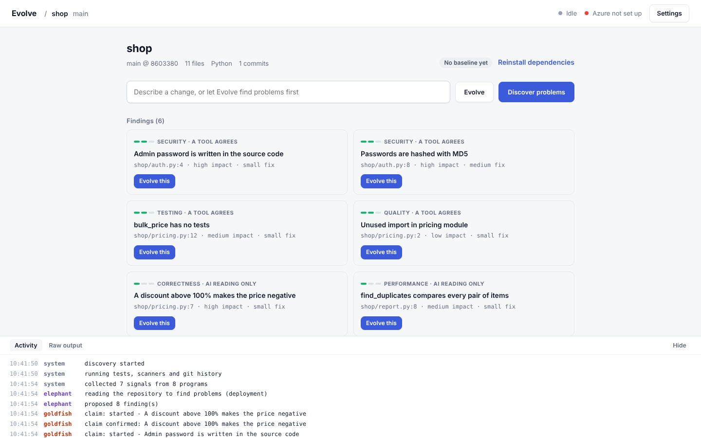

## Watch a run

A progress line at the top shows Plan, Review, Build, Verify, Judge, Decide.

The Elephant works, then the plan appears line by line as the real YAML header of the ECP file: intent, the files Pi may touch,
the files it must never touch, success criteria, verification, constraints, stop conditions, rollback, then the approach.

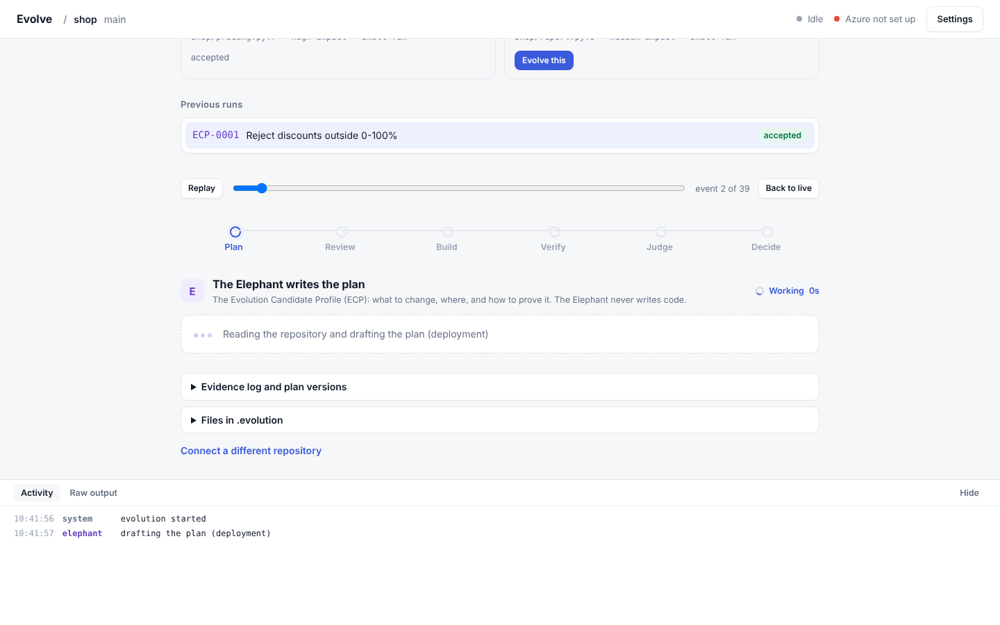
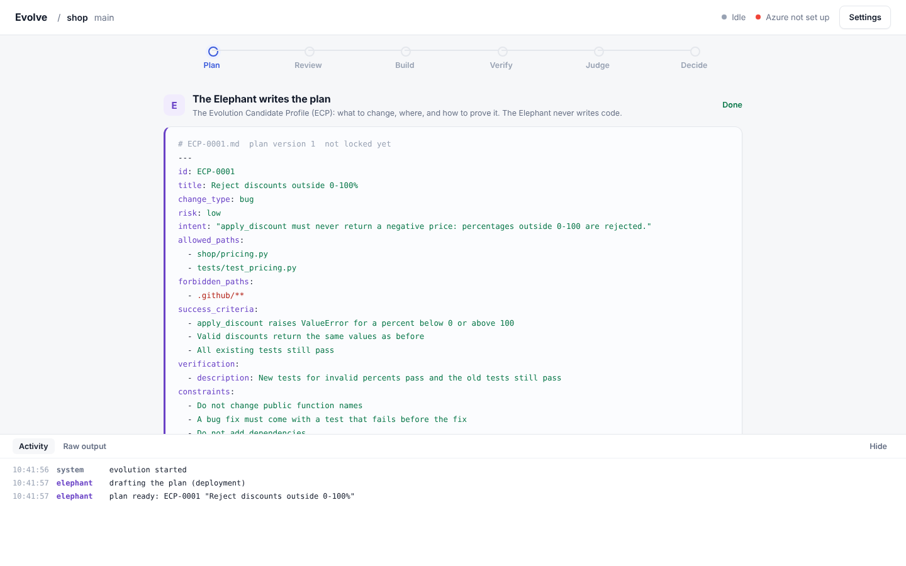

Goldfish reviewers appear as cards that fill in as each finishes. They run at the same time. A blocker sends the plan back
to the Elephant for revision.

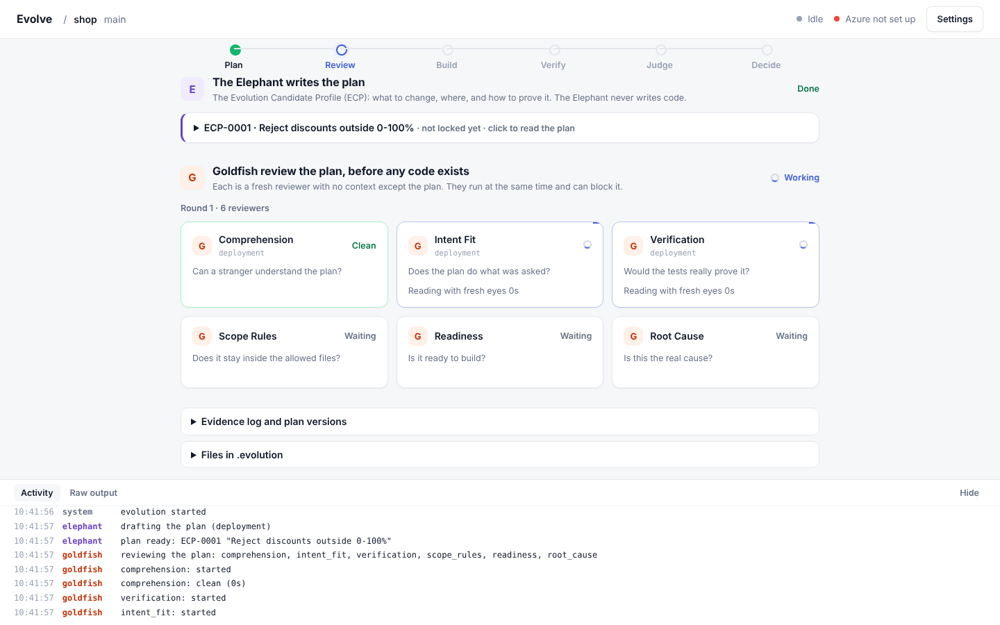

What each Goldfish receives, checks and returns:

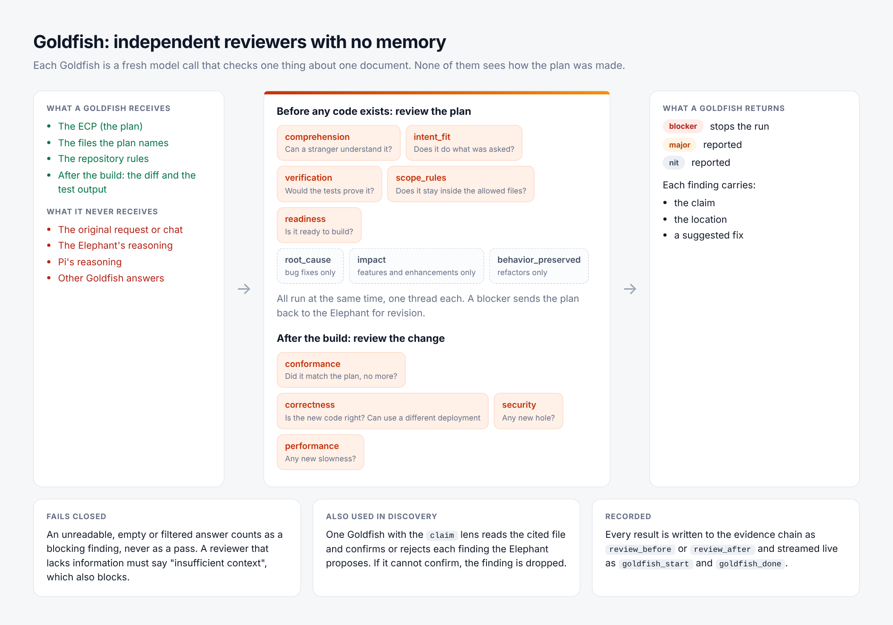

Pi's file actions are listed live. Anything outside the plan is shown as BLOCKED.

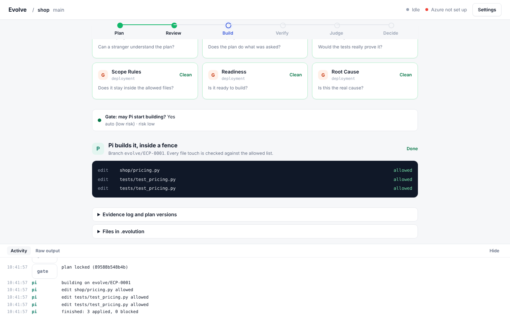

Verification is plain code: only planned files changed, the repository's tests, and proof that new tests fail on the old
code. The real diff is shown.

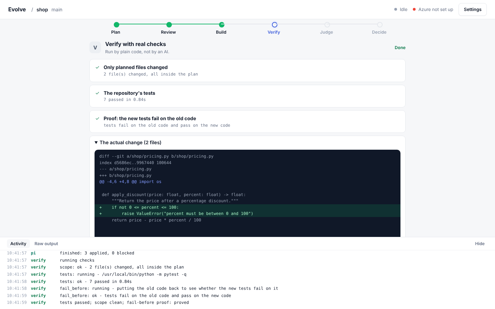

The decision lists its reasons.

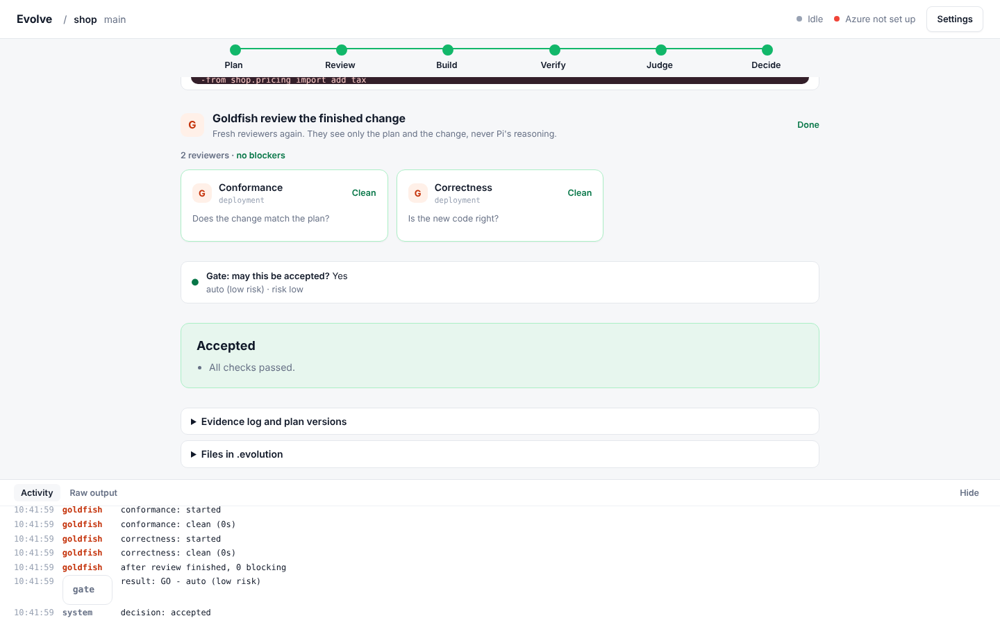

## Evidence and files

Two folded sections at the bottom of the same page: the evidence log of a run with a chain check plus every plan version, and the real files.

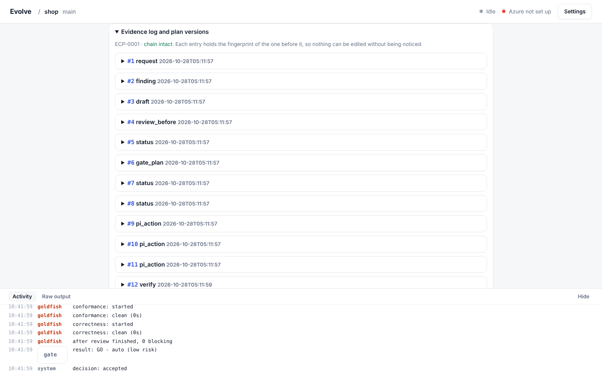

## Settings

Azure connection, plus per-repository test command, sandbox and optional per-role deployments.

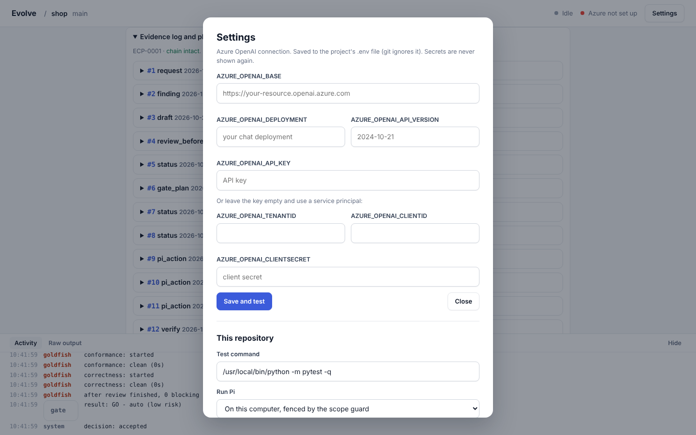

Click a previous run to replay it with the slider.
